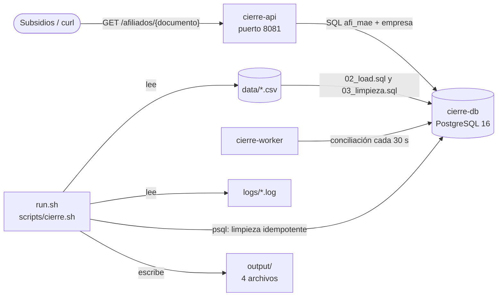

# Terminal Rescue — Cierre de afiliados

> Reparamos desde la terminal el cierre mensual de afiliados de una Caja de Compensación: servicios arriba, API de consulta funcionando, excepciones de calidad de datos reportadas y totales que cuadran con la hoja de control en cada ejecución.

## Descripción

Sistema de cierre mensual de afiliados de una Caja de Compensación Familiar. A partir de los archivos del sistema legacy genera el archivo de afiliados activos que usa Subsidios, reporta las excepciones de calidad de datos para Auditoría, cuadra los totales con la hoja de control de Operaciones y expone una API de consulta de afiliados. Este repositorio contiene el entorno reparado: los servicios levantan, la API responde y el cierre es repetible.

### Resultado

| Indicador | `output/totales.txt` | `control/hoja_control.csv` | Estado |
|---|---:|---:|:---:|
| Total de afiliados (documentos distintos) | 1500 | 1500 | ✅ Cuadra |
| Activos con empresa válida | 1194 | 1194 | ✅ Cuadra |
| Inactivos | 274 | 274 | ✅ Cuadra |
| Excepciones reportadas | 104 | — | Líneas de `excepciones.csv` |
| Error más frecuente en `logs/` | `CIE-4012` | 1424 ocurrencias | `top_error.txt` |

Detalle de las 104 excepciones: 20 `DUPLICADO`, 18 `SIN_EMPRESA`, 15 `BENEFICIARIO_HUERFANO`, 14 `CODIGO_INVALIDO`, 12 `FECHA_INVALIDA` y 25 `CRUCE_NO_COINCIDE`.

## Integrantes

- Cristian Andres Martinez Paez
- Rasmir Eduardo Rincon

## Requisitos

| Herramienta | Versión | Para qué |
|---|---|---|
| Docker Engine con Docker Compose v2 | 24 o superior | Levantar `cierre-db`, `cierre-api` y `cierre-worker` |
| Bash con `awk`, `grep`, `sed`, `sort`, `uniq` | Cualquier Linux (en Windows: Git Bash o WSL) | Ejecutar `./run.sh` |
| Python | 3.8 o superior | Ejecutar `./validator` |
| `curl` | Cualquiera | Consultar la API |

El puerto 8081 debe estar libre en la máquina.

## Instalación y ejecución

Desde una copia limpia del repositorio, en este orden:

1. Crear la configuración local a partir de la plantilla (`.env` no se sube a Git).
2. Levantar los tres servicios con Docker Compose.
3. Verificar que `cierre-db`, `cierre-api` y `cierre-worker` estén en `running`.
4. Ejecutar el cierre, que genera `output/`.

```bash
cp .env.example .env
docker compose up -d --build
docker compose ps
./run.sh
```

Para volver al estado inicial (borra contenedores, base y `output/`) y comprobar que todo se reconstruye desde cero:

```bash
./reset.sh
./run.sh
./run.sh
```

## Configuración

Todas las variables están en `.env.example` y se copian a `.env`, que está en `.gitignore`. Las contraseñas solo viven en `.env`: el código las lee de variables de entorno.

| Variable | Para qué sirve | Ejemplo |
|---|---|---|
| `POSTGRES_DB` | Nombre de la base que crea el contenedor cierre-db al iniciar | `cierre` |
| `POSTGRES_USER` | Usuario dueño de la base en cierre-db | `cierre` |
| `POSTGRES_PASSWORD` | Contraseña de ese usuario (definirla en `.env`) | `cambiar-clave` |
| `DATABASE_HOST` | Host al que se conectan cierre-api y cierre-worker; es el nombre del servicio de Compose, no `localhost` | `cierre-db` |
| `DATABASE_PORT` | Puerto de PostgreSQL dentro de la red de Docker | `5432` |
| `DATABASE_NAME` | Base a la que se conectan la API y el worker; igual a `POSTGRES_DB` | `cierre` |
| `DATABASE_USER` | Usuario de conexión de la API y el worker; igual a `POSTGRES_USER` | `cierre` |
| `DATABASE_PASSWORD` | Contraseña de conexión; igual a `POSTGRES_PASSWORD` | `cambiar-clave` |
| `API_PORT` | Puerto del equipo anfitrión donde se publica cierre-api | `8081` |
| `WORKER_INTERVAL_SECONDS` | Cada cuántos segundos concilia cierre-worker; debe ser un entero sin unidad | `30` |

## Arquitectura

El entorno tiene tres servicios definidos en `docker-compose.yml` que se comunican por la red interna de Docker Compose usando el nombre de cada servicio. El cierre corre en el equipo anfitrión.



| Componente | Qué hace |
|---|---|
| **cierre-db** | PostgreSQL 16. Al crearse ejecuta `db/init/`: crea las tablas (`01_schema.sql`), carga los CSV de `data/` (`02_load.sql`) y limpia los datos (`03_limpieza.sql`: borra duplicados conservando la primera aparición y normaliza fechas). Tiene healthcheck con `pg_isready`. |
| **cierre-api** | Servicio HTTP en Python publicado en el puerto 8081. Consulta `afi_mae` y `empresa` en cierre-db y responde `GET /afiliados/{documento}`. |
| **cierre-worker** | Proceso en Python que cada `WORKER_INTERVAL_SECONDS` segundos concilia en cierre-db el número de registros contra documentos distintos y lo escribe en su log. |
| **run.sh** | Si cierre-db está arriba, reaplica la limpieza con `psql`; después ejecuta `scripts/cierre.sh`, que lee `data/` y `logs/` y escribe `output/`. |

cierre-api y cierre-worker esperan a que cierre-db esté sana (`depends_on: condition: service_healthy`).

## Uso

Consulta de un afiliado con `GET /afiliados/{documento}`:

```bash
curl http://localhost:8081/afiliados/1098765432
```

Respuesta (código 200):

```json
{
  "documento": "1098765432",
  "nombre": "JUAN CARLOS PEREZ GOMEZ",
  "estado": "ACTIVO",
  "empresa": "EMPRESA ABC"
}
```

Documento inexistente:

```bash
curl -i http://localhost:8081/afiliados/0000000001
```

```json
{"error": "afiliado no encontrado"}
```

La respuesta llega con código 404. El campo `estado` vale `ACTIVO`, `INACTIVO` o `INVALIDO` (código de estado distinto de A e I) y `empresa` va vacía si el afiliado no tiene empresa válida.

`./run.sh` genera en `output/`:

| Archivo | Contenido |
|---|---|
| `afiliados_activos.csv` | `documento,nombre,estado,cod_empresa,empresa,beneficiarios,ultimo_aporte`: un registro por afiliado activo con empresa válida; `ultimo_aporte` en `YYYY-MM` |
| `excepciones.csv` | `documento,tipo,detalle` con `DUPLICADO`, `SIN_EMPRESA`, `BENEFICIARIO_HUERFANO`, `CODIGO_INVALIDO`, `FECHA_INVALIDA` y `CRUCE_NO_COINCIDE` |
| `totales.txt` | `total_afiliados`, `activos`, `inactivos` y `excepciones` en formato `clave=valor` |
| `top_error.txt` | `codigo_error` y `ocurrencias` del código `CIE-####` más frecuente en `logs/` |

## Pruebas

Con el entorno arriba, `./validator check` ejecuta las pruebas públicas del contrato (servicios, API, salidas, totales y repetibilidad) y `./validator entregables` revisa los documentos.

```bash
./validator check
./validator entregables
```

Comprobaciones manuales y resultado esperado:

| Comando | Resultado esperado |
|---|---|
| `docker compose ps` | `cierre-db`, `cierre-api` y `cierre-worker` en `running` |
| `curl -s http://localhost:8081/afiliados/1098765432` | JSON del afiliado con código 200 |
| `./run.sh; md5sum output/* > /tmp/a; ./run.sh; md5sum output/* \| diff /tmp/a -` | Sin diferencias: el cierre es repetible |
| `cat output/totales.txt control/hoja_control.csv` | `total_afiliados`, `activos` e `inactivos` iguales |

Consulta para confirmar en la base que ya no hay duplicados (los dos números deben ser iguales):

```bash
docker compose exec cierre-db psql -U cierre -d cierre -c "SELECT count(*), count(DISTINCT nro_doc) FROM afi_mae"
```

```sql
SELECT count(*) AS registros, count(DISTINCT nro_doc) AS documentos FROM afi_mae;
```

## Documentación

- [incident-report.md](incident-report.md): síntoma, diagnóstico, comandos y solución de los 10 incidentes.
- [evidence/](evidence/): salida de terminal que demuestra cada arreglo (un archivo por incidente).
- [AI_USAGE.md](AI_USAGE.md): cómo usamos la inteligencia artificial y qué corregimos.
- [docs/diccionario.md](docs/diccionario.md): diccionario de datos y reglas del cierre.

## Qué resolvimos

Corregimos la configuración que tumbaba al worker (intervalo `30s` en vez de `30`) y el host de la base (`cierre-database` en vez de `cierre-db`). Arreglamos el error 500 de la API cuando el segundo nombre está vacío. Reescribimos el cierre: ahora lee `data/`, aplica las reglas del diccionario (duplicados, empresa, beneficiarios, estados, fechas y cruce con Caja Oriente), cuenta el error más frecuente de los logs, cuadra los totales con la hoja de control y produce salidas idénticas cada vez que se ejecuta. La base se limpia de duplicados al crearse.

### Incidentes resueltos

El detalle de cada uno está en [incident-report.md](incident-report.md).

| # | Problema | Solución | Evidencia |
|---:|---|---|---|
| 1 | `cierre-worker` en `Exited (1)` | `WORKER_INTERVAL_SECONDS=30` (entero) en `.env.example` | [01-worker.txt](evidence/01-worker.txt) |
| 2 | La API no conecta a la base | `DATABASE_HOST=cierre-db` (nombre del servicio) | [02-api-db.txt](evidence/02-api-db.txt) |
| 3 | El cierre no lee su entrada | `scripts/cierre.sh` lee `data/`; scripts con permiso de ejecución | [03-entrada.txt](evidence/03-entrada.txt) |
| 4 | Miles de líneas de log | `CIE-4012` con 1424 ocurrencias, calculado en `top_error.txt` | [04-top-error.txt](evidence/04-top-error.txt) |
| 5 | Duplicados, sin empresa, huérfanos, códigos inválidos | `03_limpieza.sql` borra duplicados; el resto va a `excepciones.csv` | [05-calidad-datos.txt](evidence/05-calidad-datos.txt) |
| 6 | La consulta del afiliado responde 500 | Nombre sin partes vacías, `LEFT JOIN` y estados inválidos controlados en `app.py` | [06-api-500.txt](evidence/06-api-500.txt) |
| 7 | Fechas en formatos no soportados | Se normalizan a `YYYY-MM-DD` o se reportan como `FECHA_INVALIDA` | [07-fechas.txt](evidence/07-fechas.txt) |
| 8 | Extracto de Caja Oriente con otro formato | Cruce sin ceros a la izquierda; 25 `CRUCE_NO_COINCIDE` | [08-caja-oriente.txt](evidence/08-caja-oriente.txt) |
| 9 | Totales que no cuadran | Reglas del diccionario: 1500 / 1194 / 274 | [09-totales.txt](evidence/09-totales.txt) |
| 10 | El cierre solo funciona una vez | `mkdir -p`, salidas sobrescritas, entrada intacta y orden fijo | [10-repetible.txt](evidence/10-repetible.txt) |

## Limitaciones y pendientes

- Las fechas inválidas se reportan pero se dejan tal cual en la base; corregirlas requiere el dato real de Operaciones.
- Los afiliados sin empresa, los beneficiarios huérfanos y los códigos de estado inválidos se reportan como excepción pero no se corrigen, porque falta información en el origen.
- La API devuelve `INVALIDO` para estados distintos de A e I; el contrato no define ese caso.
- En Windows, run.sh y los scripts se ejecutan con Git Bash; en PowerShell se usa curl.exe en lugar de curl para probar la API.
